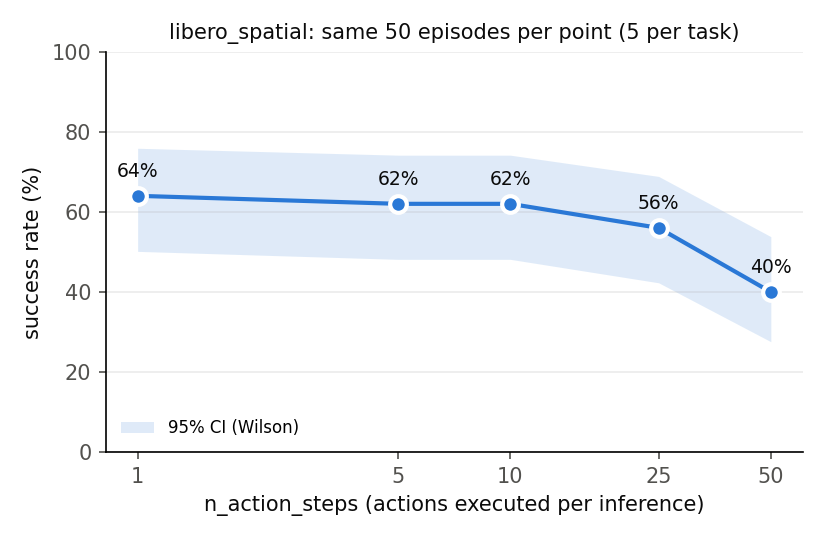
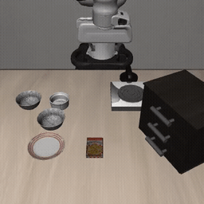
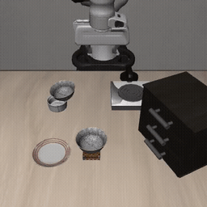

# SmolVLA 在 LIBERO 上的微调与部署分析

在 MuJoCo 仿真（LIBERO）里打通 VLA 的闭环：微调 → 闭环评测 → 部署参数消融 → 推理加速 → 失败分析。
基于 [LeRobot](https://github.com/huggingface/lerobot) 0.6.1 和 [SmolVLA](https://huggingface.co/lerobot/smolvla_base)（4.5 亿参数，SmolVLM2 主干加 flow-matching 动作专家）。

权重：[yutongzhu/smolvla-libero-ft20k](https://huggingface.co/yutongzhu/smolvla-libero-ft20k)、[yutongzhu/smolvla-libero-spatial-only-10k](https://huggingface.co/yutongzhu/smolvla-libero-spatial-only-10k)
评测结果与失败标注：[yutongzhu/smolvla-libero-eval-results](https://huggingface.co/datasets/yutongzhu/smolvla-libero-eval-results)

所有数字都来自一张 RTX 4090（48GB），在 LIBERO-Spatial（10 个任务）上测得。评测固定种子 1000、10 个环境并行，同一任务的第 i 个回合在各次实验中初始场景相同，所以模型之间用**逐回合配对**比较（精确 McNemar 检验），不只比平均值。

## 结论

| | 结果 |
|---|---|
| 微调 20k 步 | **78%**（n=10），官方 checkpoint 69%（配对 p=0.14） |
| 只调 `n_action_steps`（50 → 10），不重新训练 | 同一模型 68% → **78%** |
| 推理加速：BF16 + `torch.compile` + 去噪 10 → 5 步 | 单次推理 266 → **37 ms（7.2×）**，闭环成功率 **81%**，不下降 |
| 只用 spatial 数据（26% 的回合、一半步数） | 80%，与全量数据的 78% 持平（p=0.83） |
| 失败分析 | 微调把抓错物体从 23 次降到 10 次，但引入了放置偏差（0 → 6–10 次） |

100 回合下，95% 置信区间约 ±8 个百分点，上表的差异都没有达到 p<0.05，这里如实报告方向和 p 值。

## 1. 闭环成功率（每行 100 回合）

| 模型 | 训练数据 | 步数 | n_action_steps | 去噪 | 精度 | 成功率（95% CI） |
|---|---|---|---|---|---|---|
| `HuggingFaceVLA/smolvla_libero`（官方） | — | — | 1 | 10 | FP32 | 69%（59–77） |
| 本项目微调 | 4 个 suite | 20k | 50（继承自 base） | 10 | FP32 | 68%（58–76） |
| 本项目微调 | 4 个 suite | 20k | 1 | 10 | FP32 | 75%（66–82） |
| 本项目微调 | 4 个 suite | 20k | **10** | 10 | FP32 | **78%（69–85）** |
| 本项目微调 | 4 个 suite | 20k | 10 | 5 | FP32 | 81%（72–87） |
| **本项目微调（部署配置）** | 4 个 suite | 20k | 10 | 5 | **BF16 + compile** | **81%（72–87）** |
| 本项目微调 | **仅 spatial** | 10k | 10 | 10 | FP32 | 80%（71–87） |

| 配对比较 | 变化 | 失败→成功 / 成功→失败 | p |
|---|---|---|---|
| 官方 n=1 → 微调 n=1（同一 n） | +6 | 18 / 12 | 0.36 |
| 官方 n=1 → 微调 n=10 | +9 | 19 / 10 | 0.14 |
| 微调 n=50 → n=10 | +10 | 23 / 13 | 0.13 |
| 去噪 10 → 5 步 | +3 | 12 / 9 | 0.66 |
| FP32 → BF16 + compile（5 步去噪） | 0 | 8 / 8 | 1.00 |
| 全量 20k → 仅 spatial 10k | +2 | 12 / 10 | 0.83 |

训练曲线（n=50，相同的 50 回合）：2.5k 步 18% → 5k 16% → 10k 42% → 20k 70%，20k 步时仍未饱和。

## 2. 动作块执行步数消融（官方 checkpoint）

SmolVLA 每次推理输出 50 步的动作块，执行前 n 步后重新推理。n 越大，对推理频率的要求越低（≥ 20 Hz / n），但开环执行越久。



| n_action_steps | 1 | 5 | 10 | 25 | 50 |
|---|---|---|---|---|---|
| 所需推理频率 | 20 Hz | 4 Hz | 2 Hz | 0.8 Hz | 0.4 Hz |
| 成功率（相同的 50 回合） | 64% | 62% | 62% | 56% | 40% |

- n=1 → 10 没有损失（p=1.0），推理频率可以从 20 Hz 降到 2 Hz。
- n=1 → 50 显著下降（p=0.017）：开环执行 2.5 秒，抓空后无法纠正。
- 微调模型从 `smolvla_base` 继承了 n=50，改成 10 后从 68% 升到 78%。**部署参数也是超参数，要在闭环里扫。**

## 3. 推理延迟（RTX 4090，单帧，预热 20 次、测 100 次，GPU 独占）

| 配置 | 去噪 | p50 ms | p90 ms | 推理频率 | 20 Hz 下最小 n |
|---|---|---|---|---|---|
| FP32 | 10 | 266 | 286 | 3.8 Hz | 6 |
| BF16 | 10 | 255 | 283 | 3.9 Hz | 6 |
| BF16 | 5 | 162 | 171 | 6.2 Hz | 4 |
| BF16 + compile | 10 | 68 | 69 | 14.8 Hz | 2 |
| BF16 + compile | 5 | **37** | **37** | **27.2 Hz** | **1** |

“20 Hz 下最小 n”= ⌈p90 / 50 ms⌉，即异步执行时一个动作块至少要撑过一次推理。

- **BF16 为什么几乎不加速**：`torch.profiler` 显示一次推理要发起约 2.4 万个小 CUDA kernel，GPU 计算只有 57 ms，瓶颈在 CPU 下发。所以降精度没用，`torch.compile` 融合算子才有用（3.9×），去噪步数减半再快 1.8×。
- **编译冷启动**：第一次推理编译耗时 124 秒，真机部署前要先预热。
- **测量纪律**：有评测在并行跑时测出 442 ms，独占 GPU 时是 266 ms，干扰让数字虚高了 66%。

## 4. 失败分析

按[标注规范](results/failure_labels_README.md)逐个看失败回合，每个回合只标最早出现的失败原因：

| 模型 | 失败数 | 抓错物体 | 没抓住 | 放置偏差 |
|---|---|---|---|---|
| 官方，n=1 | 31 | 23 | 8 | 0 |
| 微调 20k，n=1 | 25 | 14 | 5 | 6 |
| 微调 20k，n=10 | 22 | 10 | 2 | 10 |

- LIBERO-Spatial 靠空间关系区分两只一模一样的碗（如“在 ramekin 上的那只”），官方模型 74% 的失败是去抓了另一只碗。
- 微调明显减少了抓错和没抓住，但带来了放置偏差。在同一 n=1 下就有 6 次，所以主要来自微调本身；n=10 的开环执行又多了 4 次（不显著）。
- 任务 5（“pick up the black bowl on the ramekin”）在各组评测中都是最低或并列最低（30–60%）。

| 成功：任务 0 | 失败：任务 5 |
|---|---|
|  |  |

## 5. 训练与评测一致性

| 检查项 | 结论 |
|---|---|
| 相机方向 | 一致：评测帧与训练帧原方向相关系数 0.87–0.96，各种翻转下 ≤ 0.33 |
| 相机映射 | agentview → `image` → `camera1`，腕部 → `image2` → `camera2` |
| 分辨率 | 不一致：评测渲染 360 px，训练数据 256 px。官方模型改用 256 px 后 69% → 75%（p=0.21） |
| 混合精度 | `lerobot-eval` 开启 AMP 时默认用 FP16，要显式设成 BF16 才和测延迟时一致 |

**与论文的差距**：SmolVLA 论文（[arXiv 2506.01844](https://arxiv.org/abs/2506.01844)）报告 LIBERO-Spatial 为 90%，本项目的评测设置下官方 checkpoint 为 69%。第三方复现 SMILE（[arXiv 2608.29432](https://arxiv.org/abs/2608.29432)）报告的 SmolVLA 基线也偏低。已排除相机方向问题；分辨率对齐后有改善，但不显著。本项目所有对比都在同一评测设置下进行。

## 复现

需要 Linux + NVIDIA GPU（LIBERO 只支持 Linux）。在中国大陆，先 `export HF_ENDPOINT=https://hf-mirror.com`。

```bash
bash scripts/setup.sh
```

```bash
STEPS=20000 BATCH=32 SAVE_FREQ=2500 scripts/train.sh
```

只用 spatial 数据训练（回合列表由 `scripts/audit_dataset.py` 生成）：

```bash
RUN=ft_spatial_only STEPS=10000 EPISODES_FILE=results/data_audit/spatial_episodes.json scripts/train.sh
```

闭环评测（每个任务 10 回合）：

```bash
EPISODES=10 N_ACTION_STEPS=10 scripts/eval.sh outputs/smolvla_libero_ft/checkpoints/020000/pretrained_model ft20k_n10
```

两次评测的逐回合配对比较：

```bash
python scripts/compare_evals.py official_n1 ft20k_n10
```

n_action_steps 消融、推理延迟（GPU 必须空闲）、汇总：

```bash
scripts/sweep_n_action_steps.sh
```

```bash
python scripts/bench_latency.py --policy outputs/smolvla_libero_ft/checkpoints/020000/pretrained_model
```

```bash
python scripts/collect_results.py
```

## 训练和部署必须一致的地方

- **相机名**：`smolvla_base` 用 `camera1..3`，LIBERO 叫 `image`、`image2`，训练和评测要传同一个 `rename_map`（`scripts/common.sh`）。
- **归一化统计量**：随 checkpoint 保存在 `policy_preprocessor*` 里；只用部分回合训练时，LeRobot 仍用全量数据的统计量。
- **`n_action_steps`**：从 `smolvla_base` 微调的 checkpoint 默认为 50，评测时要显式设置。
- **分辨率和精度**：见第 5 节。
- **评测并行数**：要配对比较的评测，必须用同一个 `EVAL_BATCH`。

## 无头云主机的坑

| 现象 | 原因 | 解决 |
|---|---|---|
| 评测卡住、无报错 | LIBERO 首次导入时等待 Y/N 输入 | `setup.sh` 自动回答；长任务加 `< /dev/null` |
| 镜像下载报 401 | Xet 存储后端 | `HF_HUB_DISABLE_XET=1`（`common.sh` 已设） |
| 数据集重复下载 | LeRobot 用自己的缓存目录 | 下载时加 `--cache-dir ~/.cache/huggingface/lerobot/hub` |
| 评测视频快 4 倍 | 按 80 fps 编码，一帧是一个 20 Hz 控制步 | 转 GIF 时加 `setpts=4*PTS` |
