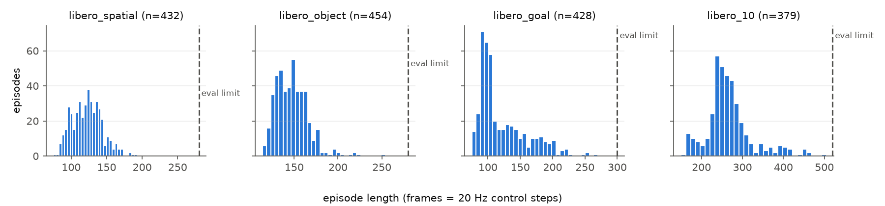

# SmolVLA 在 LIBERO 上的微调与部署分析

在 MuJoCo 仿真（LIBERO）里打通 VLA 的完整闭环：数据审计 → 微调 → 闭环评测 → 部署参数消融 → 推理加速。
基于 [LeRobot](https://github.com/huggingface/lerobot) 0.6.1 和 [SmolVLA](https://huggingface.co/lerobot/smolvla_base)（4.5 亿参数，SmolVLM2 主干加 flow-matching 动作专家，可训练参数 1 亿）。

所有数字都在一张 RTX 4090（48GB）上实测。成功率都在 LIBERO-Spatial（10 个任务）上测：固定种子 1000，10 个环境并行。同一任务的第 i 个回合在不同实验里初始场景完全相同，所以模型之间用**逐回合配对**比较（精确 McNemar 检验），而不只比平均值。

## 结论速览

| | 结果 |
|---|---|
| 微调 20k 步 + 部署参数调优 | **78%**，官方 checkpoint 为 69%（100 回合，配对 p = 0.14，未达显著） |
| 只调 `n_action_steps`（50 → 10），不重新训练 | 同一个微调模型 68% → **78%** |
| 推理加速（BF16 + `torch.compile` + 去噪 10 → 5 步） | 单次推理 266 → **37 ms（7.2×）**，闭环成功率 78% → 81%（p = 0.66，未下降） |
| 数据配比实验：只用 spatial 数据（26% 的数据、一半步数） | 80%，与全量数据 78% 持平（p = 0.83） |
| 最终可部署配置 | BF16 + compile + 5 步去噪 + n = 10：一次推理用不到一个 50 ms 控制周期，成功率 81% |

## 结果

### 1. 闭环成功率（每行 100 回合）

| 模型 | 训练数据 | 步数 | n_action_steps | 去噪步数 | 成功率（95% CI） |
|---|---|---|---|---|---|
| `HuggingFaceVLA/smolvla_libero`（官方参照） | — | — | 1 | 10 | 69%（59–77） |
| 本项目微调 | 4 个 suite 全量 | 20k | 50（继承自 base 的默认值） | 10 | 68%（58–76） |
| 本项目微调 | 4 个 suite 全量 | 20k | **10** | 10 | **78%（69–85）** |
| 本项目微调 | 4 个 suite 全量 | 20k | 10 | **5** | **81%（72–87）** |
| 本项目微调（T5） | **仅 spatial** | 10k | 10 | 10 | 80%（71–87） |

配对比较（失败→成功 / 成功→失败，精确 McNemar）：

| 对比 | 变化 | 翻转 | p |
|---|---|---|---|
| 微调模型 n = 50 → n = 10 | +10 | 23 / 13 | 0.13 |
| 官方 → 微调（n = 10） | +9 | 19 / 10 | 0.14 |
| 官方 → spatial-only 微调 | +11 | 20 / 9 | 0.06 |
| 去噪 10 步 → 5 步 | +3 | 12 / 9 | 0.66 |
| 全量数据 20k → 仅 spatial 10k | +2 | 12 / 10 | 0.83 |

100 回合时，成功率的 95% 置信区间约为 ±8 个百分点，以上差异都没有达到 p < 0.05。这里如实报告方向和 p 值，不把它们写成“显著提升”。

训练曲线（n = 50，每个点是相同的 50 个回合）：2.5k 步 18% → 5k 步 16% → 10k 步 42% → 20k 步 70%。10k 步之后仍在上升，说明 20k 步还没训练饱和。

### 2. 动作块执行步数消融（官方 checkpoint）

SmolVLA 每次推理输出 50 步的动作块。执行其中前 n 步后再重新推理：n 越大，对推理频率的要求越低（只需 ≥ 20 Hz / n），但开环执行的时间越长。


| n_action_steps | 1 | 5 | 10 | 25 | 50 |
|---|---|---|---|---|---|
| 所需推理频率 | 20 Hz | 4 Hz | 2 Hz | 0.8 Hz | 0.4 Hz |
| 成功率（相同的 50 回合） | 64% | 62% | 62% | 56% | 40% |

- n = 1 → 10：64% → 62%，配对 p = 1.0，**没有损失**。推理频率可以从 20 Hz 降到 2 Hz。
- n = 1 → 50：64% → 40%，配对 p = **0.017**，**显著下降**。开环执行 2.5 秒，抓空之后无法纠正。

微调模型同样受影响：它从 `smolvla_base` 继承了 n = 50 的默认值，改成 10 后成功率从 68% 升到 78%。**部署参数也是超参数，必须在闭环里扫。**

### 3. 推理延迟（RTX 4090，单帧，预热 20 次、测 100 次，GPU 独占）

| 配置 | 去噪步数 | p50 ms | p90 ms | 推理频率 | 20 Hz 下最小 n | 显存峰值 |
|---|---|---|---|---|---|---|
| FP32 | 10 | 266 | 286 | 3.8 Hz | 6 | 0.97 GB |
| BF16 | 10 | 255 | 283 | 3.9 Hz | 6 | 0.97 GB |
| BF16 | 5 | 162 | 171 | 6.2 Hz | 4 | 0.97 GB |
| BF16 + compile | 10 | 68 | 69 | 14.8 Hz | 2 | 1.05 GB |
| BF16 + compile | 5 | **37** | **37** | **27.2 Hz** | **1** | 1.03 GB |

“20 Hz 下最小 n”= ⌈p90 / 50 ms⌉：异步执行时，一个动作块至少要撑过一次推理的时间。

**为什么 BF16 几乎没有加速？** 用 `torch.profiler` 看一次推理：GPU 实际计算 57 ms，但要发起约 2.4 万个很小的 CUDA kernel，CPU 下发它们的时间远多于 GPU 计算时间。推理受限于 CPU 下发开销，所以降精度没用，减少 kernel 数才有用：`torch.compile` 做算子融合带来 3.9×，去噪步数减半再带来 1.8×。

**测量纪律**：同一配置在有评测并行跑时测出 442 ms，GPU 独占时是 266 ms，干扰让数字虚高了 66%。延迟必须在 GPU 独占时测。

闭环成功率是在 FP32、未编译的条件下测的；BF16 和 compile 只测了延迟。

### 4. 数据审计（`lerobot/libero`，1693 条演示）

[`scripts/audit_dataset.py`](scripts/audit_dataset.py) 只读 parquet，不解码视频，1 分钟跑完。

| suite | 演示 | 帧数占比 | 长度中位数 | 最长 | 评测步数上限 |
|---|---|---|---|---|---|
| spatial | 432 | 19.4% | 123 | 193 | 280 |
| object | 454 | 24.5% | 146 | 254 | 280 |
| goal | 428 | 19.0% | 105 | 270 | 300 |
| libero_10 | 379 | 37.1% | 259 | 505 | 520 |



发现：
- **配比**：评测目标 spatial 只占训练帧的 19%，长时序的 libero_10 占 37%。这是 T5 只用 spatial 数据训练的动机。
- **已经过过滤**：每个任务 29–50 条演示（原版每个任务 50 条，少了 15%）；静止帧（no-op）为 0。原计划里“裁掉开头静止帧”的清洗步骤不需要做。
- **元数据错误**：`info.json` 标的是 fps = 10，但一帧实际对应一个 20 Hz 控制步。50 步的动作块是 2.5 秒，不是 5 秒。
- **步数余量**：goal（90%）和 libero_10（97%）的最长演示接近评测步数上限，策略只要稍慢就会被判为超时失败。
- **归一化一致**：从原始帧重新计算的 mean/std，和 `meta/stats.json`、官方 checkpoint 里存的统计量差异为 0.0000 个标准差。
- **规则校验**：第一版的“从未抓取”规则报了 76 条异常，全部来自“开抽屉”和“推盘子”这两个本来就不需要抓取的任务。改成和同一任务的其他演示比较后，误报消失。

### 5. 训练与评测一致性检查

| 检查项 | 结论 |
|---|---|
| 相机方向（[`check_camera_orientation.py`](scripts/check_camera_orientation.py)） | 一致：评测帧与训练帧在原方向下的相关系数为 0.87–0.96，各种翻转下 ≤ 0.33 |
| 相机映射 | agentview → `image` → `camera1`，腕部 → `image2` → `camera2`，两条链路一致 |
| 分辨率 | **不一致**：评测渲染 360 px，训练数据 256 px。官方模型在 256 px 下 69% → 75%（配对 p = 0.21，未达显著） |
| 画质 | 训练帧来自压缩视频，有压缩伪影；评测帧是无损渲染 |

### 6. 成功和失败案例（微调模型，n = 10）

| 成功：任务 0 | 失败：任务 5 |
|---|---|
|  |  |

失败回合的过程：机械臂接近正确的碗，夹爪闭合但没抓住，然后空手做完“放到盘子上”的动作，回头重抓时用完了步数。动作块开环执行时不会检查抓取是否成功。

人工标注了官方模型的 31 个失败回合（[`results/failure_labels_official_n1.csv`](results/failure_labels_official_n1.csv)）：74% 是走向了错误的碗（`approach_wrong_dir`），26% 是没抓住（`grasp_miss`），没有放置失败。LIBERO-Spatial 的 10 个任务只靠空间关系（例如“在 ramekin 上的那只碗”）区分两只一模一样的碗，所以主要难点在语言和空间的对应，而不在动作本身。任务 5（“pick up the black bowl on the ramekin”）在全部 6 组评测里都是成功率最低的任务（含并列，30–60%）。

### 与论文的差距

SmolVLA 论文（[arXiv 2506.01844](https://arxiv.org/abs/2506.01844)，表 2）报告 0.45B 模型在 LIBERO-Spatial 上为 90%（每个任务 10 次）。按本项目的评测设置，官方 checkpoint 测得 69%。第三方复现（SMILE，[arXiv 2608.29432](https://arxiv.org/abs/2608.29432)，每个任务 50 回合）得到的 SmolVLA 四个 suite 平均为 74.0%。差距的原因没有完全查明：已排除相机方向；分辨率对齐后有改善但不显著。本项目的所有对比都在同一评测设置下进行。

## 复现

需要 Linux + NVIDIA GPU，LIBERO 只支持 Linux。在中国大陆，先设置 `export HF_ENDPOINT=https://hf-mirror.com`。

```bash
bash scripts/setup.sh
```

数据审计（CPU）：

```bash
python scripts/audit_dataset.py
```

微调（4090 上 3.66 步/秒，20k 步约 1.5 小时）：

```bash
STEPS=20000 BATCH=32 SAVE_FREQ=2500 scripts/train.sh
```

只用 spatial 数据训练：

```bash
RUN=ft_spatial_only STEPS=10000 SAVE_FREQ=2500 EPISODES_FILE=results/data_audit/spatial_episodes.json scripts/train.sh
```

闭环评测（每个任务 10 回合，10 个环境并行，约 10–35 分钟）：

```bash
EPISODES=10 N_ACTION_STEPS=10 scripts/eval.sh outputs/smolvla_libero_ft/checkpoints/020000/pretrained_model ft20k_n10
```

n_action_steps 消融：

```bash
scripts/sweep_n_action_steps.sh
```

两次评测的逐回合配对比较：

```bash
python scripts/compare_evals.py official_n1 ft20k_n10
```

推理延迟（GPU 必须空闲）：

```bash
python scripts/bench_latency.py --policy outputs/smolvla_libero_ft/checkpoints/020000/pretrained_model
```

汇总所有结果：

```bash
python scripts/collect_results.py
```

## 训练和部署必须一致的地方

- **相机名**：`smolvla_base` 预训练时用 `camera1..3`，LIBERO 叫 `image`、`image2`。训练和评测都要传同一个 `rename_map`（`scripts/common.sh`），`eval.sh` 会按 checkpoint 自动加。
- **归一化统计量**：state 和 action 用 MEAN_STD，统计量随 checkpoint 一起保存在 `policy_preprocessor*` 里。只用部分回合训练时，LeRobot 仍然使用全量数据的 `meta/stats.json`。
- **`n_action_steps`**：从 `smolvla_base` 微调得到的 checkpoint 默认是 50，评测时要显式设置。
- **分辨率**：LeRobot 的 LIBERO 环境默认渲染 360 px，`lerobot/libero` 是 256 px。
- **评测并行数**：`EVAL_BATCH` 会改变每个回合分到的种子，要比较的结果必须用同一个值。

## 环境坑（无头云主机）

| 现象 | 原因 | 解决 |
|---|---|---|
| `egl_probe` 编译失败 | 缺 cmake | `apt-get install cmake build-essential`（`setup.sh` 已包含） |
| 镜像下载报 401 | Xet 存储后端不接受镜像的授权 | `HF_HUB_DISABLE_XET=1`（`common.sh` 已设） |
| 评测卡住、无报错 | LIBERO 首次导入时等待交互式 Y/N 提问 | `setup.sh` 自动回答；长任务一律加 `< /dev/null` |
| 训练卡在 “Creating policy” | 静默下载 VLM 主干 | `setup.sh` 预下载 |
| 数据集重复下载 | LeRobot 使用自己的缓存目录 | `hf download --cache-dir ~/.cache/huggingface/lerobot/hub` |
| 评测视频播放速度是实际的 4 倍 | 视频按 80 fps 编码，一帧是 20 Hz 的一个控制步 | 转 GIF 时加 `setpts=4*PTS` |

## 目录

```
scripts/common.sh                  共享路径、数据集、rename_map、HF 设置
scripts/setup.sh                   安装依赖，预下载数据集、checkpoint、VLM 主干和 LIBERO 资源
scripts/audit_dataset.py           数据审计 → results/data_audit/
scripts/train.sh                   从 smolvla_base 微调（EPISODES_FILE 可选回合子集）
scripts/eval.sh                    单次闭环评测 → results/<tag>/
scripts/eval_ckpts.sh              评测一次训练的多个 checkpoint（CKPTS 过滤，跳过已评测的）
scripts/sweep_n_action_steps.sh    n_action_steps 消融并画图
scripts/compare_evals.py           两次评测的逐回合配对比较 + McNemar 检验
scripts/check_camera_orientation.py  评测帧与训练帧的方向和分辨率检查
scripts/bench_latency.py           推理延迟和显存 → results/latency*.json
scripts/collect_results.py         汇总 results/ 成 markdown 表
docs/ONE_DAY_PLAN.md               一天的任务安排
docs/RESUME.md                     简历条目与面试要点
```
